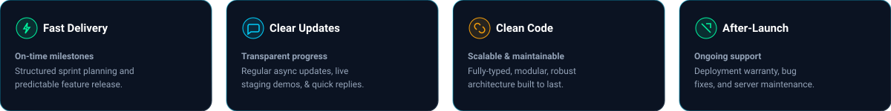
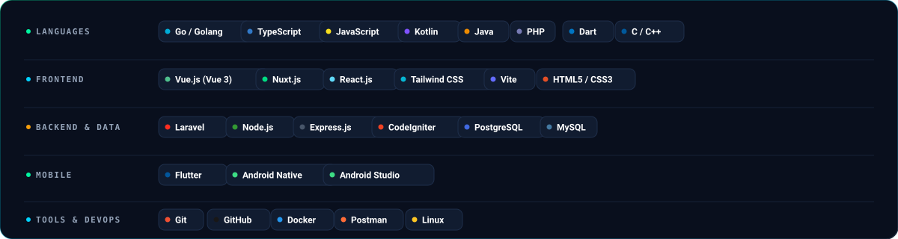

  

  
  &nbsp;
  
  &nbsp;
  
  &nbsp;
  

  

I'm a Full-Stack Web & Mobile Developer based in **Jombang, Indonesia (UTC+7)**, dedicated to building reliable, high-performance, and scalable digital products for businesses **since 2021**. I specialize in **Native Android**, **Cross-Platform Flutter**, modern **Web SPAs & Dashboards (Vue/Nuxt/React)**, resilient **Backend APIs (Golang/Laravel/Node)**, and automated **Point of Sale (POS) & ERP solutions**. Got a project in mind? I'm always open for collaboration and contracts.

  

  

  

  

  

  

  

  

